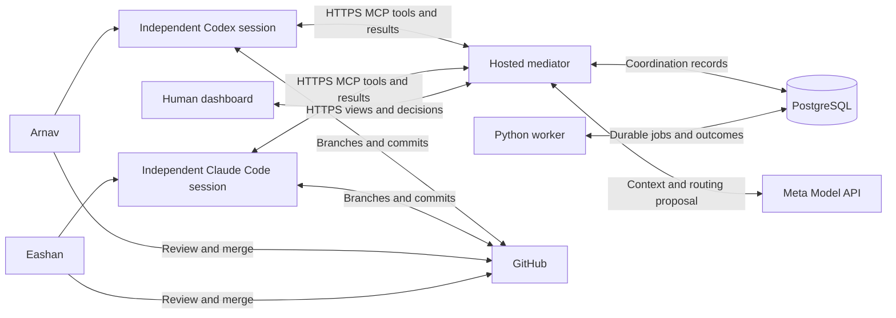

# Tandem

**Project skeleton only.** This repository starts with the folder structure from Draft and this README. Empty `.gitkeep` placeholders preserve the folders in Git. Application code, configuration, detailed documentation, and tests will be added by the team. There are no working setup or run commands, active workflows, or deployed services.

Arnav and Eashan Patel are designing a hosted mediator that helps their independent coding agents coordinate work. Arnav prompts Codex on his machine; Eashan prompts Claude Code on his. The mediator records assignments, messages, file claims, and human approvals. It never launches or controls either agent. Git is the ground truth for code; PostgreSQL is the ground truth for coordination.

The project is planned for the Meta Global AI Developer Hackathon, Indie track. The team-provided deadline is **4 November 2026 at 9:00 PM America/New_York (Eastern Time)**. Tandem is the product and repository name; the team name remains undecided.

The planned full architecture will include Auth0, trust boundaries, worker policies, and the optional GitHub enforcement extension. The arrows above describe future interactions, not existing connections.

## Planned documentation

The paths below identify documents to be written; these files are not included in this initial skeleton.

1. Both developers: project overview (`docs/project-overview.md`), architecture (`docs/architecture.md`), and open decisions (`docs/open-decisions.md`).
2. Agree on the protocol (`docs/protocol.md`), state machine (`docs/state-machine.md`), and data model (`docs/data-model.md`) before implementing independently.
3. Document collaboration (`docs/collaboration.md`) to divide work, then the repository map (`docs/repository-map.md`) to identify each owning file.
4. Define testing (`docs/testing.md`) and the future demo (`docs/demo-scenario.md`) to establish the evidence needed for completion.

## Layout

| Area | Intended responsibility |
| --- | --- |
| `apps/web/` | React, TypeScript, Vite, Tailwind, shadcn/ui, TanStack Query human dashboard |
| `services/mediator/` | One FastAPI/Python MCP backend and a normal Python worker sharing domain policies |
| `agent-integrations/` | Future connection plans, instruction templates, optional durable local receipt helper |
| `infrastructure/` | Future Render, Docker, and local PostgreSQL configuration |
| `docs/` | Protocol, consistency, identity, recovery, implementation guidance, and unresolved decisions |
| `.github/` | Future PR review checklist and CI configuration |

## Planned implementation references

- Coordination: routing and contracts (`docs/routing-and-contracts.md`), delivery and recovery (`docs/delivery-and-recovery.md`), file ownership (`docs/file-ownership.md`).
- Access: authentication (`docs/authentication.md`), agent integration (`docs/agent-integration.md`), GitHub integration (`docs/github-integration.md`).
- Operations: configuration (`docs/configuration.md`), deployment (`docs/deployment.md`), testing (`docs/testing.md`).

The envelope and lifecycle remain design proposals; there is no claim of protocol conformance. Detailed design documents and repository-level agent instructions will be added by the team as implementation begins.
