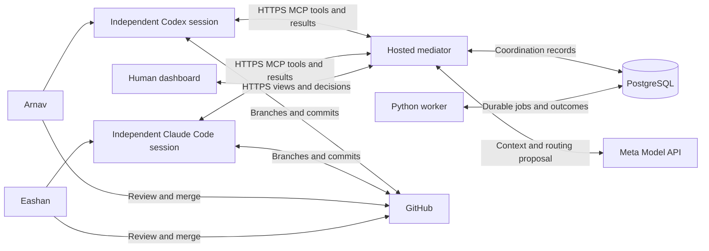

# Tandem

A hosted mediator that helps their independent coding agents coordinate work. Person 1 prompts Codex on his machine; Person 2 prompts Claude Code on his. The mediator records assignments, messages, file claims, and human approvals. It never launches or controls either agent. Git is the ground truth for code; PostgreSQL is the ground truth for coordination.

## Frontend

Hosted frontend: **[tandem-red-two.vercel.app](https://tandem-red-two.vercel.app)**. It currently shows connection setup until Auth0 and the backend are configured. See the [deployment instructions](apps/web/README.md#vercel-deployment).

The human dashboard is implemented in [`apps/web`](apps/web). It connects only to Auth0 and the real mediator HTTP API. There is no demo mode, sample workspace, browser-local database, or simulated agent activity. Until you configure authentication and implement the backend endpoints, it shows setup or connection errors.

```sh
cd apps/web
npm ci
# Copy .env.example to .env.local and supply the four connection settings.
npm run dev
```

Use Node.js 22.12+. See the [frontend README](apps/web/README.md) for setup and tests, and the [API contract](apps/web/API.md) for the exact endpoints and response shapes to implement in `services/mediator`. The Auth0 browser flow and authenticated HTTP client are implemented; the backend, agent integrations, database, worker, and provider services remain for the team to build.

## Planned architecture



The planned full architecture will include Auth0, trust boundaries, worker policies, and the optional GitHub enforcement extension. The arrows above describe future service interactions, not existing connections.

## Planned documentation

The paths below identify documents still to be written. Frontend setup and integration guidance is already included in `apps/web/README.md`.

1. Both developers: project overview (`docs/project-overview.md`), architecture (`docs/architecture.md`), and open decisions (`docs/open-decisions.md`).
2. Agree on the protocol (`docs/protocol.md`), state machine (`docs/state-machine.md`), and data model (`docs/data-model.md`) before implementing independently.
3. Document collaboration (`docs/collaboration.md`) to divide work, then the repository map (`docs/repository-map.md`) to identify each owning file.
4. Define testing (`docs/testing.md`) and the future demo (`docs/demo-scenario.md`) to establish the evidence needed for completion.

## Layout

| Area | Intended responsibility |
| --- | --- |
| `apps/web/` | React/TypeScript/Vite dashboard with Tailwind, shadcn-style primitives, TanStack Query, Auth0 and one real HTTP data client |
| `services/mediator/` | One FastAPI/Python MCP backend and a normal Python worker sharing domain policies |
| `agent-integrations/` | Future connection plans, instruction templates, optional durable local receipt helper |
| `infrastructure/` | Future Render, Docker, and local PostgreSQL configuration |
| `docs/` | Protocol, consistency, identity, recovery, implementation guidance, and unresolved decisions |
| `.github/` | Future PR review checklist and CI configuration |

## Planned implementation references

- Coordination: routing and contracts (`docs/routing-and-contracts.md`), delivery and recovery (`docs/delivery-and-recovery.md`), file ownership (`docs/file-ownership.md`).
- Access: authentication (`docs/authentication.md`), agent integration (`docs/agent-integration.md`), GitHub integration (`docs/github-integration.md`).
- Operations: configuration (`docs/configuration.md`), deployment (`docs/deployment.md`), testing (`docs/testing.md`).

The envelope and lifecycle remain design proposals; there is no claim of protocol conformance. Detailed design documents and repository-level agent instructions will be added by the team as implementation begins.
