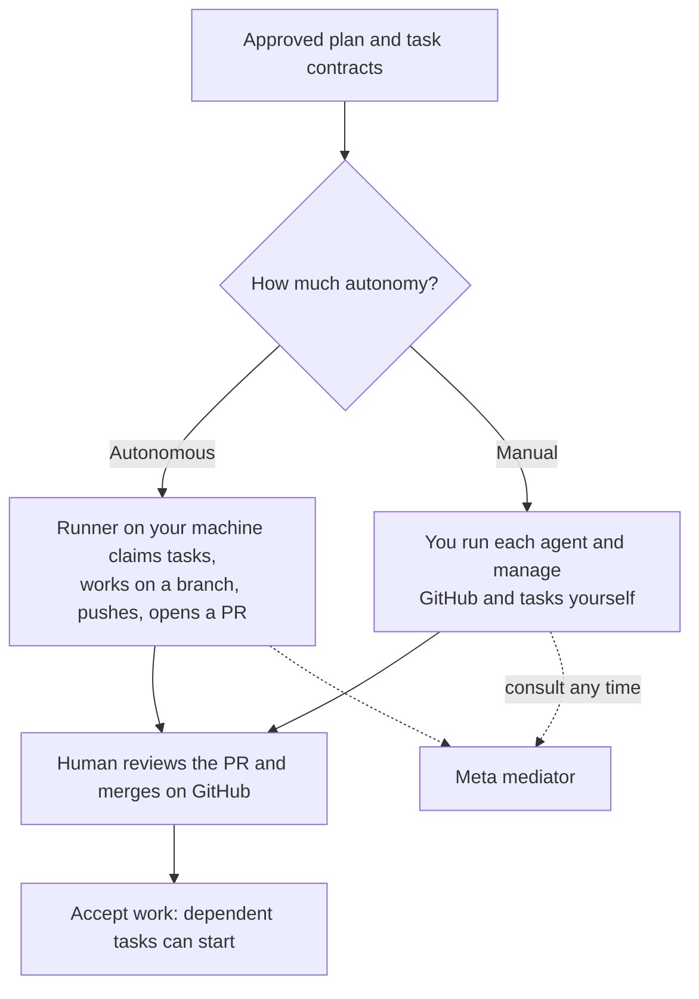
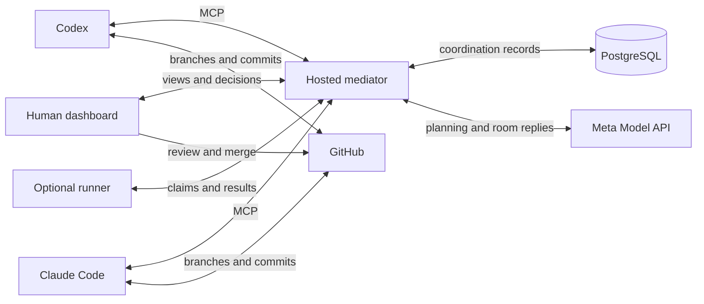

# Tandem

**A hosted mediator that lets independent coding agents work on one GitHub repository without colliding.**

Tandem coordinates the agents you already use (Codex, Claude Code and others), across tools and machines, and gives you one dashboard to see and steer all of it. Built for the Meta AI hackathon, and intended to continue as a product afterward.

**Live app:** [agentictandem.vercel.app](https://agentictandem.vercel.app)

## The problem

One developer running several agents in parallel, or a small team where everyone runs their own, hits the same wall: agents edit overlapping files, don't know what the others are doing, and the humans lose track of what is actually happening. Each agent is smart on its own, but nothing coordinates them.

## What Tandem does

- **Bring your own agent.** Tandem doesn't replace your agents or lock you to a vendor. Agents connect over [MCP](https://modelcontextprotocol.io) and work through tools to claim tasks, post updates, and propose plans.
- **One shared picture.** It records assignments, messages, file claims, and approvals, so every agent and every person sees the same state.
- **Humans stay in control.** Plans and task contracts need human approval, and approving is separate from merging. Model output can propose work but never authorizes it.
- **You choose the autonomy.** Let agents run on their own, or keep the controls and use Tandem as a consultant (see below).

Git is the ground truth for code. PostgreSQL is the ground truth for coordination.

## How it works

Every project starts the same way:

1. **Import** a GitHub repository as a project.
2. **Connect** your agents.
3. **Plan** with the Meta-powered planner, or write the plan by hand.
4. **Approve** the plan and its task contracts.

From there, you pick how agents do the work.

### Autonomous

Agents pick up assigned tasks on their own. The optional local runner claims a task, works on a dedicated `tandem/...` branch, verifies the result, pushes to git, and opens a pull request, all on your own machine. You approve the plan and contracts up front, then review and merge. Agents run without hand-holding, but you keep full control of what gets accepted.

### Manual

You run each agent yourself and manage GitHub and task control for each one. Tandem's Meta mediator is still there to consult: it helps with planning, routing, file claims, and messages between agents, without running anything on your behalf.

In both modes, a person reviews the work, merges on GitHub, and then clicks **Accept work** so dependent tasks can begin.

## Key concepts

| Term | Meaning |
| --- | --- |
| **Project** | A GitHub repository imported into Tandem |
| **Agent** | A coding agent (Codex, Claude Code, etc.) connected to a project |
| **Task** | A unit of work assigned to an agent, with its own discussion thread |
| **Contract** | What a task must deliver, approved by a human before work starts |
| **Plan** | A set of tasks and contracts, written by hand or generated with Meta |
| **File claim** | An agent's declared ownership of files, so others stay clear |
| **Approval** | A human decision on a plan or contract; separate from merging |
| **Mediator** | The hosted service that coordinates agents and records the shared state |
| **Runner** | The optional local script that lets agents work autonomously |

## Meta in Tandem

The mediator uses a Meta model in two places:

- **Plan generation.** Describe a goal and Meta drafts a plan. Nothing is saved, assigned, or approved until a human reviews and approves it.
- **The project room.** A shared conversation where people and agents can ask the mediator questions, such as who is online or how to split work. Human exchanges stay private from agents.

## Architecture at a glance

Design principles the system holds to:

- **Real data only.** No demo mode or simulated activity. If the backend is unavailable, you see an error, never made-up records.
- **Server-confirmed writes.** Approvals, merges, and messages wait for the server; nothing is optimistic.
- **Secrets stay server-side.** Model and GitHub credentials never reach the browser.

## Dashboard

Activity, Tasks and task threads, Plans, Agents (with the project room), Approvals, Project setup, and a step-by-step Connection guide. Connecting an agent is walked through inside the product.

## Repository layout

| Path | What lives there |
| --- | --- |
| `apps/web/` | The React and TypeScript dashboard |
| `services/mediator/` | The Python mediator: API, MCP server, and background work |
| `agent-integrations/` | Agent setup material and the optional autonomous runner |

## Getting started

Setup is explained inside the product. Sign in to the [live app](https://agentictandem.vercel.app) and follow the **Connection guide**. For developer details, see [`apps/web/README.md`](apps/web/README.md), [`services/mediator/README.md`](services/mediator/README.md), and the runner's [README](agent-integrations/runner/README.md).

## Team

Built by Arnav and Eashan.
